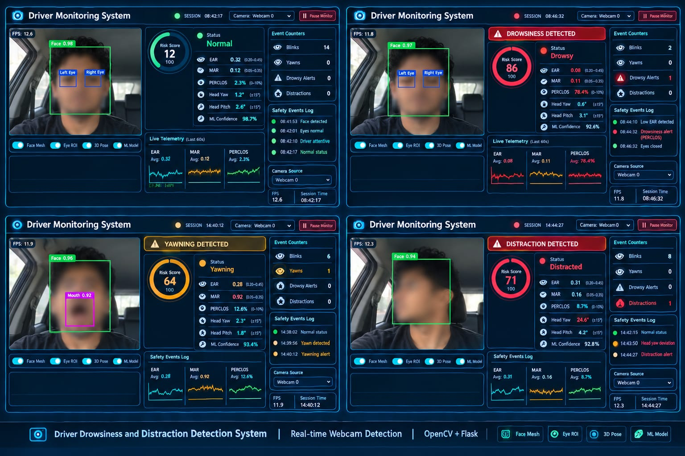
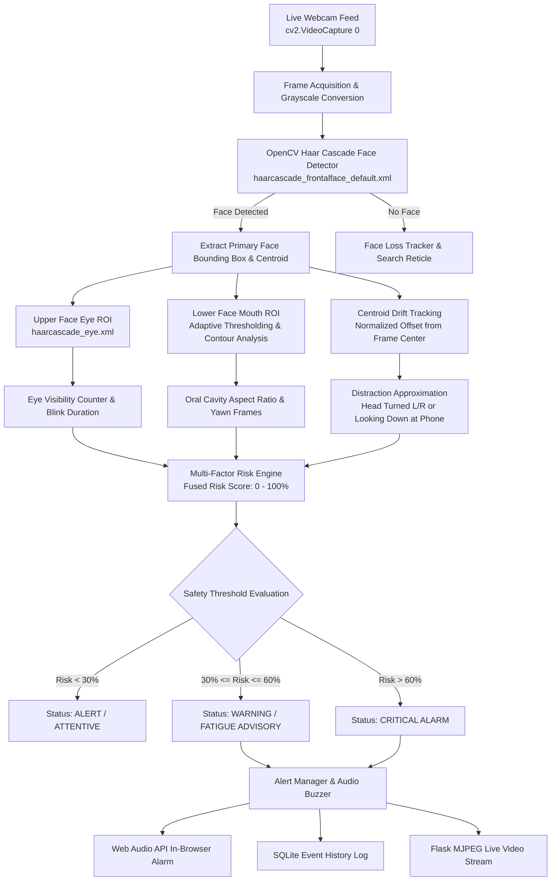

# Driver Guardian: Real-Time Webcam Driver Drowsiness and Distraction Detection System

[](https://www.python.org/)
[](https://opencv.org/)
[](https://flask.palletsprojects.com/)
[](https://www.sqlite.org/)



A real-time Computer Vision system for monitoring driver attention through a live webcam feed (`cv2.VideoCapture(0)`), detecting faces and eyes using official OpenCV Haar Cascades, estimating drowsiness and yawning via temporal tracking and mouth ROI image processing, and approximating distraction from head centroid drift.

Built using strictly **Python, OpenCV, NumPy, Flask, HTML, CSS, and JavaScript**. Contains **no MediaPipe, no deep learning, no pretrained neural networks, and no simulated detection**.

> [!NOTE]
> **Heuristic Detection Notice**: Haar Cascade performs real face and eye detection directly on live camera frames. However, eye closure, yawning, and distraction estimates are heuristic approximations and may be affected by poor lighting, eyeglasses, or unusual camera angles.

---

## 1. System Architecture & Detection Pipeline



---

## 2. Technical Features

1. **Real-Time Webcam Face Detection**:
   - Captures live camera frames using `cv2.VideoCapture(0)`.
   - Detects primary human face in every frame using `haarcascade_frontalface_default.xml`.
   - Draws HUD bounding box, centroid crosshairs, and detection status.
2. **Eye Detection & Drowsiness Tracking (`haarcascade_eye.xml`)**:
   - Searches for eyes within the upper facial region ($y \in [0.18h, 0.58h]$).
   - Distinguishes between normal involuntary blinks ($1-4$ frames, $\approx 100-150\text{ ms}$) and prolonged closed eyes ($\ge 12$ frames, $\approx 0.4-0.6\text{ s}$).
   - Maintains an eye visibility ratio buffer over a 60-frame rolling window.
3. **Yawn Estimation via Mouth Image Processing**:
   - Crops lower facial mouth region ($y \in [0.62h, 0.95h]$).
   - Applies Gaussian blur, inverted adaptive thresholding to segment the dark oral cavity void, and morphological closing.
   - Calculates Mouth Opening Metric (ratio of oral cavity height to mouth width).
   - Sustained opening ($\ge 12$ frames at metric $> 0.30$) triggers a Yawn / Fatigue warning.
4. **Centroid Drift Distraction Estimation (Heuristic Approximation)**:
   - Tracks horizontal offset ($\Delta x$) and downward tilt ($\Delta y$) of the face centroid relative to the calibrated camera center.
   - Head turned far left or right ($|\Delta x| > 0.28$) or tilted down toward lap/phone ($\Delta y > 0.24$) for $\ge 16$ frames triggers a distraction alert.
   - Clearly labeled on the HUD and API as a heuristic approximation.
5. **Camera Permission & Hardware Error Handling**:
   - Checks camera accessibility and graceful reconnection if the device is busy or permissions are not granted.
   - Renders a diagnostic troubleshooting frame with checklist when webcam index 0 is unavailable.
6. **Modern Flask Cockpit Dashboard**:
   - Glassmorphic dark HUD theme with live FPS display and circular SVG risk meter.
   - Real-time Chart.js signal waveform tracking Eye Visibility % and Mouth Opening Metric.
   - In-browser synthesized audio alarms via the Web Audio API (chime advisory vs urgent alarm siren).
   - Interactive calibration sliders for eye absence frames, yawn threshold, head drift limits, and buzzer volume.

---

## 3. Directory Structure

```
Driver_drowsiness_and_distraction_detection/
├── app.py                     # Main Flask server & MJPEG streaming endpoints
├── config.py                  # Thresholds, cascade paths, and video settings
├── requirements.txt           # Project dependencies (OpenCV, Flask, NumPy)
├── cascades/
│   ├── haarcascade_frontalface_default.xml # Official OpenCV face detector
│   └── haarcascade_eye.xml                # Official OpenCV eye detector
├── core/
│   ├── __init__.py
│   ├── face_detector.py       # Haar face detection & ROI segmentation
│   ├── drowsiness_detector.py # Haar eye visibility tracking & mouth image processing
│   ├── distraction_detector.py# Centroid drift approximation & heuristic label
│   ├── risk_engine.py         # Multi-factor risk calculation & status levels
│   ├── alert_manager.py       # Alert cooldowns & audio buzzer triggers
│   └── stream_manager.py      # cv2.VideoCapture(0) stream & HUD annotation
├── database/
│   ├── __init__.py
│   ├── db.py                  # SQLite session and alert event logging
│   └── driver_monitor.db      # SQLite database file
├── templates/
│   └── dashboard.html         # Cockpit HUD HTML with disclaimer notice
├── static/
│   ├── css/
│   │   └── style.css          # Futuristic dark glassmorphic styling
│   └── js/
│       └── dashboard.js       # Real-time telemetry poller & Web Audio engine
└── tests/
    └── test_detectors.py      # Unit & integration test suite
```

---

## 4. Setup & Running Instructions

### 1. Prerequisites
- Python 3.10+
- A built-in or USB webcam connected to your computer.

### 2. Environment Activation & Dependencies
```powershell
# In PowerShell:
.\.venv\Scripts\Activate.ps1
pip install -r requirements.txt
```

### 3. Run the Automated Tests
```powershell
python -m unittest tests/test_detectors.py
```
*(All 6 unit and integration tests verify face cascade loading, eye absence tracking, mouth cavity analysis, centroid drift, risk calculation, and camera error handling)*.

### 4. Launch the Application
```powershell
python app.py
```
Open **`http://127.0.0.1:5000`** in your browser.

---

## 5. Troubleshooting Camera Permissions
If you see the camera connection warning:
1. Ensure your webcam is plugged in and any physical privacy shutter is open.
2. In Windows: Go to **Settings $\rightarrow$ Privacy & Security $\rightarrow$ Camera**, ensure **Camera access** and **Let apps access your camera** are toggled **ON**.
3. Close other applications that may have exclusive locks on the webcam (e.g. Zoom, Microsoft Teams, Skype).
4. Click the **RECONNECT WEBCAM** button on the dashboard or select Camera Index 1 if using an external USB webcam.
